# Ostinato

Ostinato is a Baritone-derived pathfinding and automation engine for Minecraft.
It keeps the AltoClef-compatible APIs required by
[TenorClef](https://github.com/vexrypt-rgb/TenorClef) while tracking a modern
Cabaletta Baritone base.

TenorClef decides what to do. Ostinato provides movement, mining, building,
inventory, and schematic processes to make it happen. Multi-bot coordination
(`#swarm`) uses the [SIGIL](https://github.com/vexrypt-rgb/sigil) wire format
for sealed whispers.

## Compatibility

`gradle.properties` on this branch is the source of truth for the Minecraft
version of `main`.

| Minecraft | Branch | Java | Status |
| --- | --- | --- | --- |
| 26.3 | `main` | 25 | Primary line. Pairs with TenorClef `:26.3`, its primary target. |
| 1.21.11 | `1.21.11` | 21 | Previous main line. Pairs with TenorClef `:1.21.11`. |
| 1.21.11 (Conductor module edition) | `conductor-module` | 21 | Ostinato plus its Conductor module. |
| 1.21.4 | `1.21.4` | 21 | Pairs with TenorClef `:1.21.4`. |
| 1.16.1 | `1.16.1` | 8 | Legacy. Pairs with TenorClef `:1.16.1`. Gradle 4.9; do not build with JDK 21. |

Do not point a 1.21.4 TenorClef build at a jar from `1.21.11` or `main` (26.3). See
[TenorClef's wiring guide](https://github.com/vexrypt-rgb/TenorClef/blob/main/docs/OSTINATO_WIRING.md).

## Build

Java 25 is required on `main` (26.3). The `1.21.11` and `1.21.4` branches need Java 21.

On Windows:

```bat
gradlew.bat build
```

On macOS or Linux:

```sh
./gradlew build
```

The first build may take some time: Unimined downloads and remaps Minecraft for
the enabled loaders. `available_loaders` on `main` is Fabric. Build outputs go
to `dist/`. The Fabric artifact TenorClef consumes is `:fabric:build`.

## Menu

Right Control opens the menu in a world (`guiKeybind`). Settings are still the first page, and the search box still filters them. Studio, Arcade, and Tasks are at the top of the sidebar. These pictures are from the 26.3 dev client.

### Settings

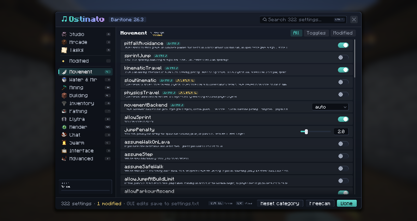

Movement, pathing, and the rest of the settings. A change is written to `settings.txt`.

### Studio

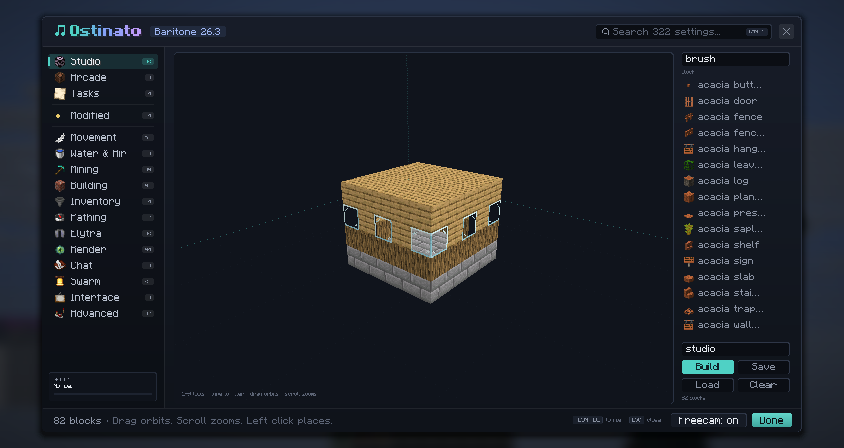

Studio is a schematic editor in the menu. The block list on the right holds every block in the game, drawn with its real item icon, and the filter box above it narrows the list. The orbit view draws each block with its real textures. Drag orbits the camera, shift-drag or middle-drag pans, and the scroll wheel zooms. Left click uses the current tool, right click erases, `[` and `]` step through the filtered list, the arrow keys nudge the camera, Ctrl+Z undoes, and Ctrl+S saves. The tool row has brush, select, fill, replace, line, sphere, hollow, wall, copy, paste, rotate, and flip; keys 1 to 9 pick the first nine, and `-` / `=` change the sphere radius. The volume starts at 24×12×24 and will not grow past 32 on a side. A save is `schematics/<name>.ostinato`; it stores block names (with any non-default block state), and saves from v1.22.0 still load. Build hands that schematic to the builder at your feet and leaves the menu open.

### Arcade

Three small games, for when a path is running and there is nothing to click.

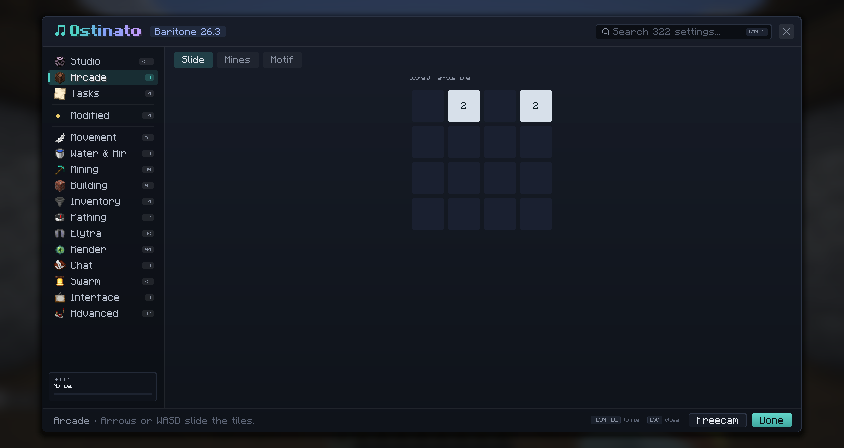

Slide is a 4×4 board. Arrows or WASD move the tiles.

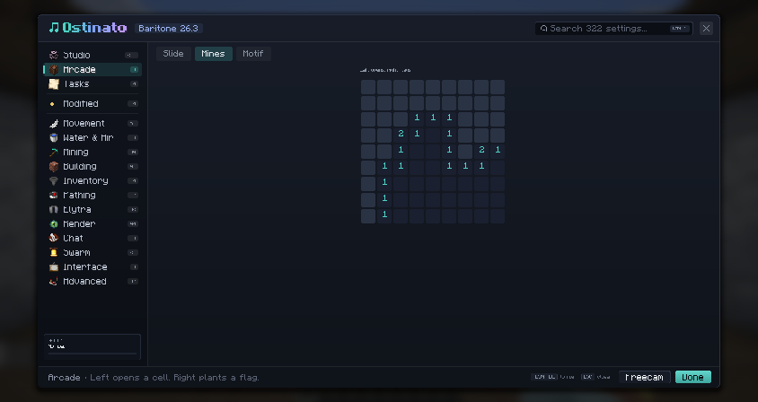

Mines is a 9×9 field with 10 mines. Left click opens a cell, right click plants a flag, and the first open cell is never a mine.

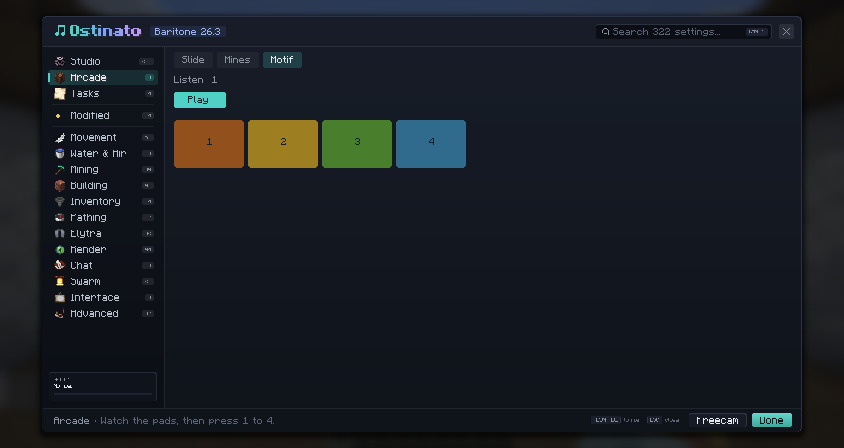

Motif plays a short pattern on four pads. Watch, then press 1 to 4 or click the pads.

## Freecam

`#freecam` (or `freecamKey`, F8) detaches the camera into a body that walks, swims, and slime-jumps with the game's own movement. Double-tap jump to fly; flying phases the camera, and the bot on a singleplayer world, through blocks. Double-tap again to land: collision comes back for both, so parkour next to the bot stays solid. These pictures are from the 26.3 dev client.

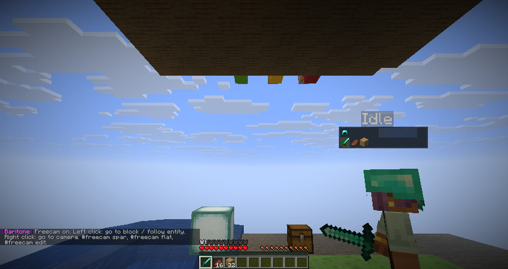

The hotbar, hearts, hunger, and the first-person arm stay on screen. F5 shows the bot's body, and the bot's hotbar is drawn above its head (with the slots of any open container). A chest the bot opens stays open for the bot without covering your view; the survival and creative inventories still draw, doll included.

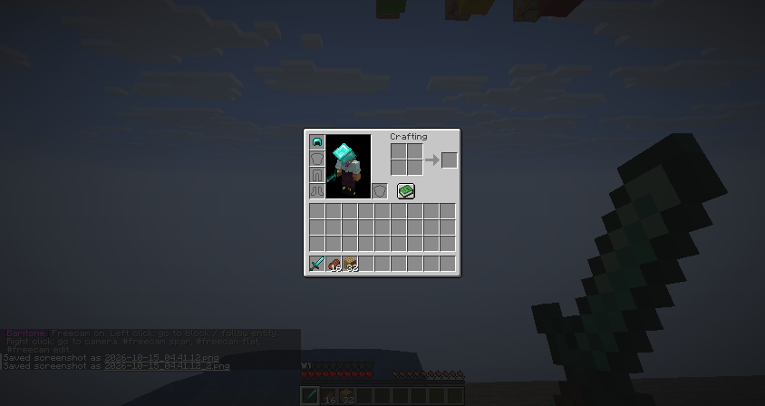

Left click follows the entity under the crosshair or sends the bot to the block; right click sends it to the camera. `#freecam spar` adds a client-only sparring ghost that fights with the bot's melee timing (strafe, sprint, jump crits); its hits only change a local health count.

### Flat canvas and edit mode

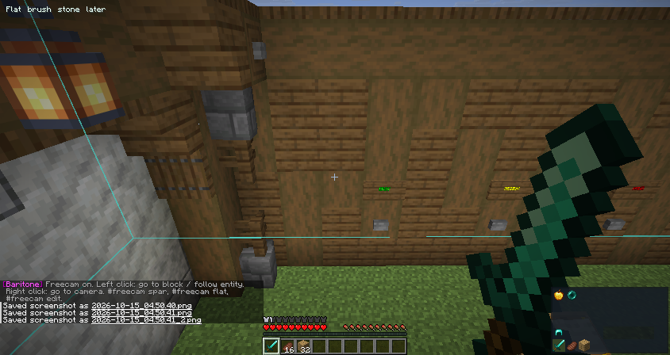

`#freecam flat` puts a 32×16×32 client-only superflat pad under the camera. You build on it with the Studio tools while the bot keeps doing its task; nothing is in the world yet. `#freecam edit` copies the current selection, or 16×12×16 around the build you look at, and lets you restyle that copy like creative: added blocks show as textured ghosts and removed blocks as red outlines.

| Command | Effect |
| --- | --- |
| `#freecam apply` | Hand the difference to the builder now and keep editing (the default is to build later) |
| `#freecam live` | Toggle building each edit as you make it; this takes over the builder |
| `#freecam done` | Build the difference and close the canvas |
| `#freecam tool <name>` | brush, select, fill, replace, line, sphere, hollow, wall, copy, paste, rotate, flip |
| `#freecam brush <block>` / `brush hand` | Lock the brush to a block, or follow the held block again (middle click picks a block) |
| `#freecam radius <1-8>` | Sphere size |
| `#freecam undo` / `clear` | Undo the last edit, or drop the canvas |

On a flat canvas, apply places only the blocks you added. In edit mode, apply also breaks the blocks you removed. Clicks on a canvas never send the bot anywhere.

Limits: these features are on 26.3 (`main`) only. Flight phases the bot only on a singleplayer world; on a server the bot is pulled back. Landing while inside a block can leave the camera stuck. `freecamGhostOpacity` is ignored on 26.3, where the body is drawn solid. The pictures show the HUD, the body, the overhead hotbar, the inventory doll, the Studio palette, and the flat canvas; spar, the edit ghost, and the builder carrying out an apply have no picture yet.

## Path view

While kinematic or physics travel is driving, Ostinato draws that plan in the world and hides Baritone's path ribbon. The card in the corner is the path status (block, distance, ETA, and the current movement). Six settings, on by default:

| Setting | What it draws |
| --- | --- |
| `renderKinCorridor` | The corridor around the block path. The next node is a green frame, the centerline is peach, and the part already walked goes grey. After a hand-back the frame goes orange, or red if the move is stuck. |
| `renderKinRollouts` | The candidate arcs for this tick. The chosen plan is green. The others are lifted beside it, orange, or red when rejected. |
| `renderKinJumps` | Takeoff, the flown arc, climb marks, and the landing. A hand-back is orange. A stuck move is a red marker. |
| `renderPhysSpeedTrail` | The tick path colored by horizontal speed, blue when slow and red when fast. |
| `renderPhysInputs` | A mark for the keys of each tick (W, sprint, jump, A, D) and a ghost box at the jump, the apex, the landing, and a grab. |
| `renderPhysSearch` | The explored search, the chosen path against the path actually flown, and a purple diamond where a replan happened. |

The pictures below are from a dev client on a parkour course. Each one is a single moment, so it does not show every color in the table.

### Kinematic

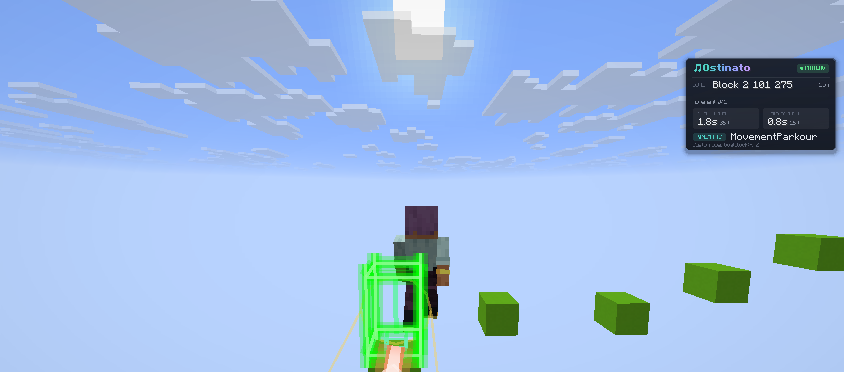

The corridor: a green frame on the next node and a peach centerline along the beam.

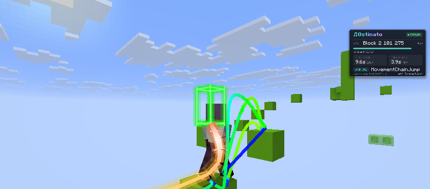

Rollouts on a chain jump. The chosen arc is green. The other candidates sit beside it.

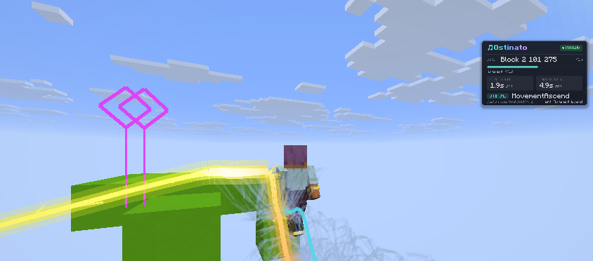

Jump marks on a climb: pink diamonds over the lip, the flown arc in yellow, and the landing in cyan.

### Physics

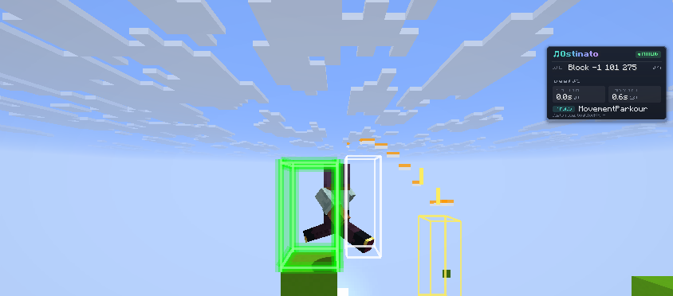

Input marks on a jump: orange jump ticks stepping out from the player, with ghost boxes for the jump and the landing.

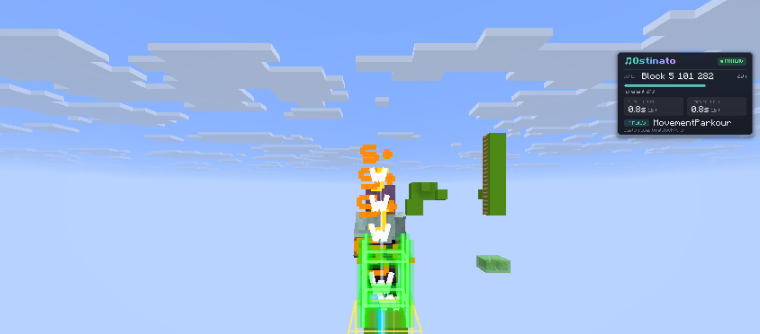

The speed trail on a fast climb, white through orange. The corridor frame is in this shot as well.

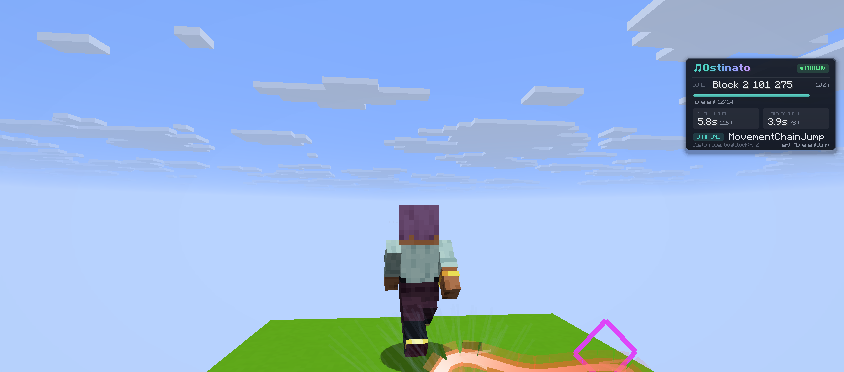

A replan on a chain jump. The purple diamond is the search marker. The peach line is the path under the player.

## TenorClef integration

Keep the trees as siblings. Build Ostinato first, then TenorClef.

| TenorClef module | Ostinato branch | Typical staged jar |
| --- | --- | --- |
| `:26.3` (primary) | `main` | release jar `ostinato-mc26.3-unoptimized-fabric-<version>.jar` → TenorClef `libs/baritone-unoptimized-fabric-ostinato-26.3.jar` |
| `:1.21.11` | `1.21.11` | `dist/baritone-unoptimized-fabric-*.jar` → TenorClef `libs/baritone-unoptimized-fabric-ostinato-1.21.11.jar` |
| `:1.21.4` | `1.21.4` | `dist/baritone-unoptimized-fabric-*.jar` → TenorClef `libs/baritone-unoptimized-fabric-1.21.4.jar` |
| `:1.16.1` | `1.16.1` | `libs/baritone-unoptimized-fabric-1.16.1.jar` |

TenorClef's 26.3 module needs a JDK 25 toolchain; Gradle itself runs on JDK 21 there.

## Native acceleration

On `main` (26.3), the brute-force jump search (`TasBrute`, used for parkour frontiers and for head-hitter jumps
without a template plan) can run in a small Rust library shipped inside the jar for Windows, Linux and macOS on x64
and arm64. It gives the same plan as the Java search, to the bit, and tests check this on every build. Measured on
an Intel Core i5-1145G7 laptop, it was 3.1x to 4.9x faster than Java on the test courses (2.3x to 2.9x on one
thread; it uses up to 4). Pathfinding (A*) and block lookups stay in Java. Details and numbers:
[docs/RUST_NATIVE.md](docs/RUST_NATIVE.md).

The Java search runs instead whenever the library cannot load (another OS or CPU, or `-Dostinato.native=false`) or
`#set nativeAcceleration false` is set. Java prints one "restricted method" warning when the library loads; start
the game with `--enable-native-access=ALL-UNNAMED` to silence it.

Building with Rust installed (`cargo`) puts the library for your machine in the jar; without it the jar has no
library and runs the Java search. Release jars carry all six.

## Movement backends

Default pathing is Baritone-compatible. On the modern target, an optional
Tungsten physics A* backend can handle goto / custom-goal travel. Mining,
digging, schematics, and inventory stay on classic Ostinato processes.

| Setting | Values | Behavior |
| --- | --- | --- |
| `movementBackend` | `baritone` | Always use classic travel |
| `movementBackend` | `tungsten` | Prefer Tungsten; use Baritone if unavailable |
| `movementBackend` | `auto` | Use Tungsten when present, otherwise Baritone |

Install a compatible Tungsten Fabric jar beside Ostinato, then
`#set movementBackend tungsten`. If Tungsten is absent, the fallback is
Baritone. Backend selection should be visible in logs; treat an unexpected
fallback as a configuration issue.

## Acknowledgements

Ostinato ports code from [Soprano](https://github.com/AverWasTaken/soprano) by AverWasTaken
(LGPL-3.0): the A* search speedups (open-set heap, cell node map, mining-cost memo, favoring cache)
and the boat steering controller used while sailing. See [CREDITS.md](CREDITS.md) for the file list.

## Movement features

Beyond upstream Baritone, Ostinato adds:

- **Kinematic travel** (`#set kinematicTravel false` to disable, on by default): plain
  walking stretches of a path (traverse, diagonal, 1-block ascend, drops up to
  3 blocks) are driven by a per-tick physics look-ahead. The controller
  simulates a set of yaw and jump choices with a copy of vanilla player
  movement, then presses the keys of the one that gets furthest along the path
  while staying on it. Anything it cannot model (breaking, placing, water,
  most of parkour) goes back to Baritone. Experimental; benchmarked with
  TenorClef's PathBench.
- **Soprano-style movement tech, found by simulation.** These features and their design come from
  [Soprano](https://github.com/AverWasTaken/soprano) (AverWasTaken's Baritone fork); credit for the ideas
  is theirs, and the ladder clutch is ported from their code. Where Soprano hand-codes each jump, Ostinato
  searches vanilla player physics offline and ships the answers as templates, flown with the same
  search at run time (`baritone.pathing.kinematic`). The simulated player now handles ladders and
  vines, so these exist on top of the neo and momentum jumps already there:
  - **Ladder and vine jumps** (`allowClimbJumps`, off by default): catch a ladder or vine in mid air
    across a gap of 1 to 4 blocks, or let go of one and land on a ledge or another ladder
    (`MovementClimbJump`).
  - **Chained jumps** (`allowMomentumJumps`, on by default): two jumps through a one block pad, landing
    with the speed the next jump needs, for gaps no single jump makes (`MovementChainJump`).
  - **Ladder clutch** (`allowLadderClutch`, off by default): survive a long fall by placing a ladder or
    vine on a wall beside the last blocks of it, then pick the ladder back up (`pickupLadders`). Needs
    one on the hotbar; a water bucket is still preferred when it is no more expensive.
  - **Experimental movement** (`experimentalMovement`): a preset, not a settings rewrite. Parkour,
    neos, momentum and climb jumps, diagonals and `kinematicTravel` act as if on, jumps cost
    `experimentalJumpBias` times as much, block placement at most `experimentalBlockPlacementPenalty`,
    and falls that hurt are taken when nothing protects you and you stay above `experimentalMinHealth`.
    Turning it off hands your own settings back.
- **Checking the simulation** (`kinematicTrace`, off by default): while a jump, climb jump or chain flies,
  every tick compares the real player with `PlayerSim`'s prediction and logs `SIMTRACE` lines (per-tick
  rows in `simtrace/simtrace.csv`, one summary per movement in `simtrace/summary.csv`): the one-tick
  prediction error, how far the whole jump drifts open loop, mismatches on being grounded, and how far
  the real look lags the commanded yaw. `-Dostinato.simbench=jump,climb,chain` (or `all`; also
  `-Dostinato.simbench.limit=N`, `-Dostinato.simbench.exit=true`) builds a course in the sky for each
  template in a superflat singleplayer world, flies it, and writes `simbench/simbench.csv` plus a
  `SIMBENCH SUMMARY` per kind: landed count and the median/p90 worst one-tick error.
- **Pitfall avoidance** (`pitfallAvoidance`, on by default): the pathfinder
  never stands on sand, gravel or concrete powder resting on a block without
  collision (air, an open fence gate, a sign…), since it can drop out from
  under the player.
- **Water and air**: 3D swim moves, underwater digging, surface travel, and
  air management that uses bubble and magma columns.
- **Boats and elytra**: boat travel, including refusing boats occupied by
  mobs, plus elytra gliding with rocket-free descent.
- **Sprint-jumping** on land (`sprintJump`, off by default on current
  benches).

## Swarm and region builds

Bots running Ostinato can form a signed, whisper-based group, share status,
and split a schematic across the roster with `#swarm build`. Partitioning is
deterministic so every member computes the same plan locally. Tokens on the
wire are SIGIL S2 (including S2S when a sender must be proven).

- [Region builds](docs/REGION_BUILD.md)
- [SIGIL](https://github.com/vexrypt-rgb/sigil)

## Development documentation

- [Porting and upstream notes](docs/PORTING.md)
- [TenorClef pairing](docs/TENORCLEF.md)
- [Movement engine](docs/MOVEMENT_ENGINE.md)
- [Rust acceleration](docs/RUST_NATIVE.md)
- [Upstream Baritone documentation](README.baritone.md)
- [Features](FEATURES.md)
- [Setup](SETUP.md)
- [Usage](USAGE.md)

## License

Ostinato is licensed under LGPL-3.0 with upstream Baritone's anime exception.
See [LICENSE](LICENSE) and preserve all applicable notices when redistributing
artifacts.

## Vibe coding / AI use

Large parts of this repository were written or edited with AI assistants
(Claude, Grok, and similar). That is vibe coding: a person set the
direction; a model produced a lot of the text. A green CI run or a
commit message is not proof that a human understood every line.

Read the diff before you run or merge it. Do not treat this as audited
software. File bugs. Do not assume the model already considered your
case.
