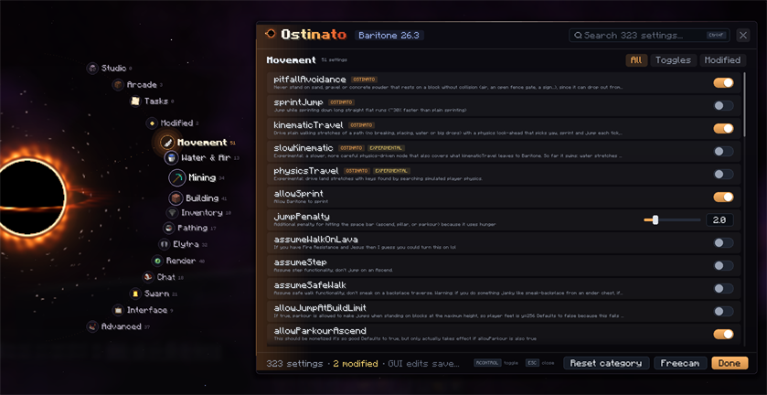
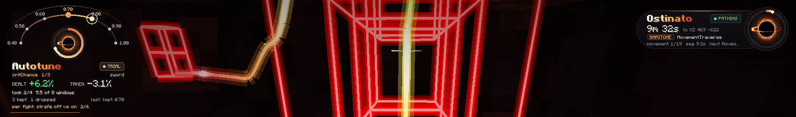

# Screen, freecam and task lists

## The Ostinato screen
Press `guiKeybind` (default Right Ctrl) to open it. It has tabs including **Tasks**. `renderPathHud` shows a path
HUD, placed by `pathHudAnchor` (default RIGHT). `#click` opens the click GUI.

### Themes (`guiTheme`)
`guiTheme` sets the look of the menu and of every Ostinato HUD card (the path card, the Autotune card, and the
freecam inventory). Change it on the Interface page or with `#set guiTheme singularity`.

- `classic` (default): the dark glass panel with a sidebar.
- `singularity`: the menu's pages orbit a black hole at the left edge of the screen. Studio, Arcade, Tasks,
  Modified and each settings category are bodies on the orbit, and one click on a body opens that page. Hovering
  the orbit magnifies the body under the cursor and pushes its neighbours apart, but clicks go to fixed slots, so
  nothing moves away from the cursor. Opening the menu flings the bodies out of the core along a spiral. Esc, Done
  or the close button pulls them back in before the menu closes. Switching category slides the new rows in. The
  header, search box, rows, tooltips and footer buttons are the same as in classic, in a darker panel.
  The HUD cards become orbit gauges. The path card is a small black hole at the screen edge whose photon ring fills
  as the trip goes on, with the ETA, the mover and the current movement in a capsule beside it. The Autotune card is
  a dome: the values the tuner can stand on are stops on an orbit around a black hole whose ring fills as the trial
  runs. The trusted value is a solid stop, the candidate a pulsing amber one, the value in force has a photon ring
  round it, and the stretch being tried is drawn between them. The numbers sit in rows below. The freecam inventory
  keeps a void-glass panel, since an item grid does not fit a gauge.

While `guiAccentColor` is at its default teal, singularity uses Hawking amber; any other accent colour is kept.
On a narrow window the orbit hides its labels (the hovered and selected bodies keep theirs) and slides partly off
the left edge, so the panel stays at least as wide as the classic one. The black hole is computed once, off the
render thread, the first time it is needed, and is drawn from a texture after that. Until it is ready, a plain disc
stands in.

## Freecam (`#freecam`)
Toggles a camera body that walks, swims, and slime-jumps with the game's own movement. The key is `freecamKey`
(default F8) and `freecamSpeed` defaults to 1. Double-tap jump to fly: flight phases the camera, and the bot on a
singleplayer world, through blocks. Double-tap again to land; collision comes back for both. `freecamGhostOpacity`
(0.35) is ignored on 26.3, where the body is drawn solid.
- The hotbar, hearts, and the first-person arm stay on screen. F5 shows the bot's body, with its hotbar (and any
  open container) drawn above its head. Container screens the bot opens do not cover the view; the survival and
  creative inventories still draw.
- Left click an entity: follow it. Left click a block: travel to it.
- Right click: travel to the camera position (`#come` does the same from chat).
- Middle click: mark an enemy for [`#pvp`](combat-and-clutch.md). Marking mobs requires `enemyMobs`, default false.
- `#freecam spar`: a client-only sparring ghost that uses the bot's melee timing. Hits change a local health count only.

### Building in freecam
- `#freecam flat`: a 32×16×32 client-only superflat pad under the camera. The bot keeps its task.
- `#freecam edit`: copy the selection, or 16×12×16 around the build you look at, and edit the copy. Added blocks are
  textured ghosts, removed blocks are red outlines.
- Nothing reaches the world until `#freecam apply` (build now, keep editing), `#freecam done` (build and close), or
  `#freecam live` (build each edit as you make it; this takes the builder). Flat apply places only added blocks;
  edit apply also breaks removed ones.
- Tools (`#freecam tool <name>`, shared with the Studio): brush, select, fill, replace, line, sphere, hollow, wall,
  copy, paste, rotate, flip. `#freecam brush <block>` locks the brush, `brush hand` follows the held block again,
  middle click picks a block, `#freecam radius <1-8>` sizes spheres, `#freecam undo` / `clear`.
- Clicks on a canvas never send the bot anywhere. 26.3 only.

## Task lists (`#tasks`)
Build a list in the Tasks tab; lists are saved in `baritone/tasks/<name>.json`.

| Command | Effect |
| --- | --- |
| `#tasks run <name>` | load and run a saved list |
| `#tasks run` | run the list open in the Tasks tab |
| `#tasks pause` / `resume` / `stop` | control it |
| `#tasks list` | saved lists |
| `#tasks status` | the running step |

Step types: `GOTO`, `MINE`, `FOLLOW`, `FARM`, `EXPLORE`, `GET_TO_BLOCK`, `BUILD`, `WAIT`, `SET`.
